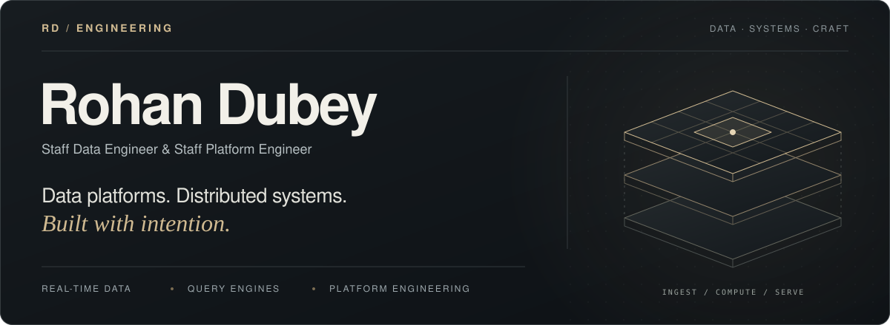
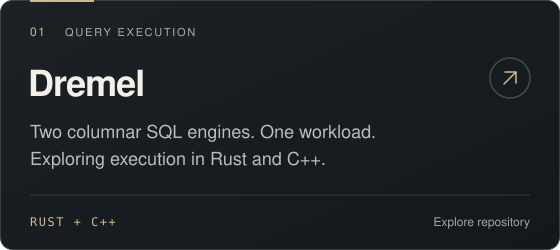
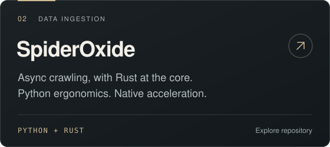
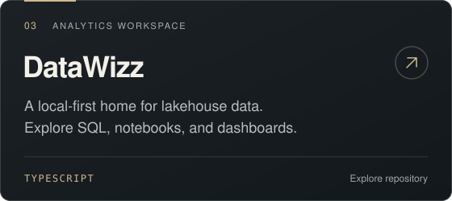
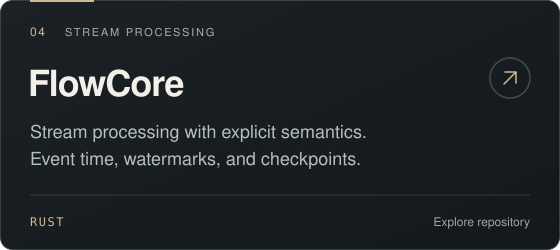
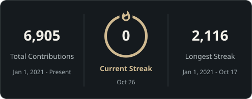
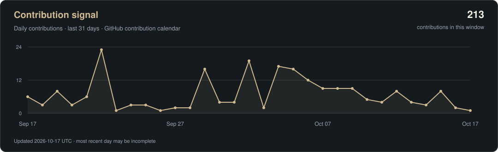

  

  <a href="https://rohankumardubey.github.io/">Portfolio ↗</a>&nbsp;&nbsp; / &nbsp;&nbsp;
  <a href="https://www.linkedin.com/in/rohan-kumar-dubey-3a9a31156/">LinkedIn ↗</a>&nbsp;&nbsp; / &nbsp;&nbsp;
  <a href="mailto:rohankumardubey497@gmail.com">Get in touch ↗</a>

 

I’m **Rohan**, a Staff Data Engineer &amp; Staff Platform Engineer working at the intersection of **distributed systems, real-time data, and performance engineering**. I build platforms with an emphasis on reliability, clear operational behavior, and the details that make them fast.

This is where I explore those ideas in code: stream processing semantics, columnar query execution, and the tradeoffs behind data-intensive systems.

> Good infrastructure earns trust quietly: observable, recoverable, and predictably fast.

 

## Selected work

Four projects exploring how data moves, how engines execute, and where performance comes from.

  
  

  
  

  <a href="https://github.com/rohankumardubey?tab=repositories">All repositories ↗</a>

## Engineering focus

| Discipline | The details that matter |
| :--- | :--- |
| **Stream processing** | Event time, watermarks, backpressure, checkpoints, and recovery. |
| **Query engines** | Columnar formats, vectorized execution, memory layout, and honest benchmarks. |
| **Distributed data** | Partitioning, consistency, fault tolerance, and lakehouse architecture. |
| **Platform engineering** | Kubernetes, infrastructure as code, observability, and developer experience. |

## Tools of the trade

**Languages** &nbsp; Rust · Go · Java · Python · Scala · C++

**Data systems** &nbsp; Kafka · Flink · Spark · Arrow · DataFusion · Iceberg · ClickHouse · Trino · DuckDB

**Infrastructure** &nbsp; Kubernetes · Docker · Terraform · AWS · Airflow · Prometheus · Grafana

  
Across the wider stack

| Layer | Technologies |
| :--- | :--- |
| Messaging | Apache Pulsar, Kafka Streams, RabbitMQ, NATS |
| Compute | Spark Structured Streaming, Ray, Apache Hadoop |
| Analytics | Presto, Dremio, Apache Druid, Apache Pinot |
| Storage &amp; formats | Delta Lake, Apache Hudi, Parquet, MinIO |
| Databases &amp; search | PostgreSQL, Cassandra, ScyllaDB, CockroachDB, TiDB, MongoDB, Redis, Elasticsearch |
| Cloud &amp; orchestration | Snowflake, BigQuery, Databricks, Argo |

## Built in the open

I learn by reading implementations, testing ideas against real workloads, and contributing fixes and improvements. My interests keep bringing me back to data engines, streaming systems, storage, and Rust infrastructure.

[Explore my open source contributions ↗](https://github.com/pulls?q=is%3Apr+author%3Arohankumardubey)

## GitHub stats

  
  

### Contribution streak

  

### Contribution signal

  

  Refreshed daily · <a href="https://github.com/rohankumardubey?tab=overview">View live GitHub activity ↗</a>

 

---

  Always up for a thoughtful conversation about systems, data, and the craft of engineering.
    
  <a href="mailto:rohankumardubey497@gmail.com"><strong>Let’s build something that lasts ↗</strong></a>

